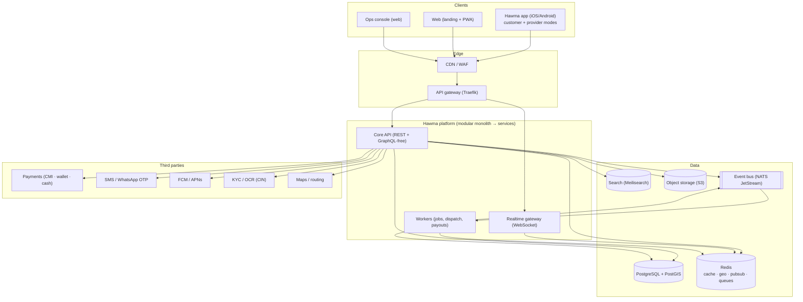

# Hawma — Platform Architecture (v1.0 draft)

> Goal (from Yassine, 2026-11-07): an application **as professional as Glovo**, with all the necessary components and a very refined architecture, redesigned from scratch.

Hawma is a **three-sided, on-demand local-services marketplace for Morocco**:

| Side | Who | Needs |
|---|---|---|
| **Customers** | Neighbours who need something done (cleaning, DIY, tutoring, errands, rides, pet care, lending) | Discover, book, track, pay, rate, get support |
| **Providers** ("Voisins-Pros") | Verified individuals and small businesses in the neighbourhood | Get jobs, schedule, get paid, build reputation |
| **Operations** | Hawma staff (support, trust & safety, finance, city ops) | Onboard, verify, dispatch, resolve disputes, pay out, analyse |

## Reading order

| # | Document | What you get |
|---|---|---|
| 01 | [Product & scope](01-product-and-scope) | Personas, capability map, MVP → V3 slicing, Glovo parity matrix |
| 02 | [System architecture](02-system-architecture) | Context, containers, component, deployment and network diagrams |
| 03 | [Domain model](03-domain-model) | ERD, aggregates, booking / payment / payout state machines |
| 04 | [Backend modules & events](04-backend-modules) | Module map, boundaries, event catalogue, API surface |
| 05 | [Key flows](05-flows) | 12 sequence diagrams: onboarding, booking, dispatch, payments, disputes, payouts… |
| 06 | [Data, geo, search & realtime](06-data-and-realtime) | Storage choices, geo-indexing, matching algorithm, realtime fabric |
| 07 | [Clients](07-clients) | Customer/provider app, ops console, web, design system, navigation maps |
| 08 | [Infrastructure & DevOps](08-infra-devops) | Environments, CI/CD, observability, scaling path, cost envelope |
| 09 | [Security, trust & compliance](09-security-trust-compliance) | Threat model, KYC, fraud, Moroccan law 09-08 / CNDP |
| 10 | [Roadmap, ADRs & open questions](10-roadmap-adrs) | Decisions with rationale, risks, what I need from you |
| 11 | [Implementation status](11-implementation-status) | What is actually built and running, with as-built diagrams |

## Architecture in one picture

## Guiding principles

1. **Modular monolith first, services when proven** — one deployable with strict module boundaries and an event bus, so each module can be extracted later without a rewrite. A 3-person team cannot operate 15 microservices.
2. **Booking is the heart** — everything (catalogue booking, on-demand dispatch, recurring jobs, errands, rides) is a `Booking` with one state machine and pluggable *fulfilment strategies*.
3. **Money is a ledger, not a column** — double-entry ledger, idempotent payment intents, reconciliation jobs. Cash is first-class.
4. **Trust is a product feature** — KYC tiers, verified-by-job reviews, deposits, insurance hooks, dispute SLAs.
5. **Morocco-first** — Darija/AR/FR, RTL, cash-on-completion, low-bandwidth, WhatsApp as a channel, CIN-based KYC, MAD currency, CNDP compliance.
6. **Operate it** — metrics, tracing, feature flags, runbooks and an ops console from day one; Glovo-grade means *operable*, not just buildable.

## Assumptions I made (tell me if any is wrong)

- "Like Glovo" = **on-demand, real-time, three-sided marketplace with live tracking, dispatch, wallet and an ops back-office**, applied to *neighbourhood services* (Hawma's concept), plus an **errands/delivery vertical** that is the closest Glovo analogue.
- Launch city: **Casablanca**, then Rabat, Marrakech, Tangier. Currency MAD only.
- Team size 2–6 engineers at the start; budget-conscious infra (single region, Dokploy-managed VPS → managed cloud later).
- Third-party providers named in the docs (CMI, specific SMS vendors, etc.) are **candidates**, not confirmed; contracts and API fit must be verified before commitment.
