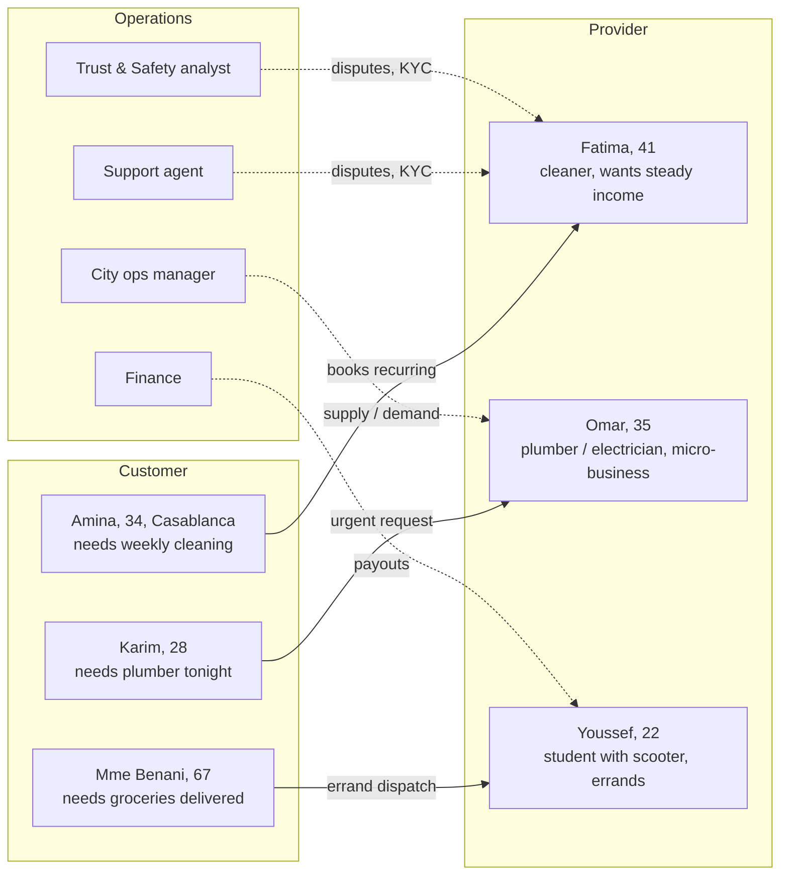
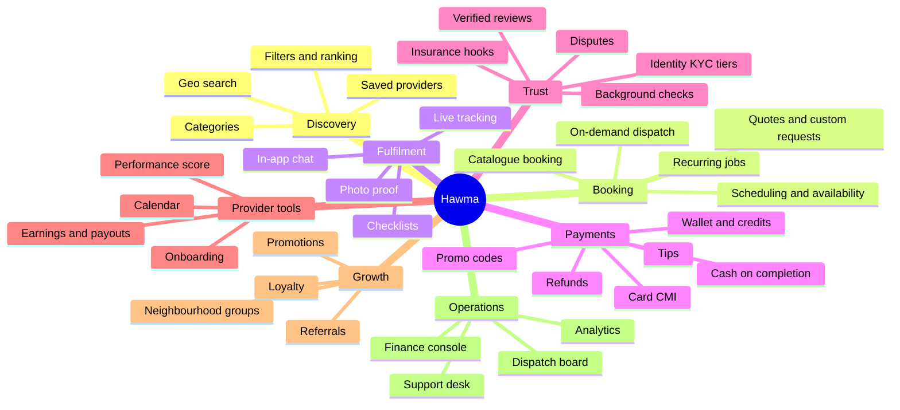
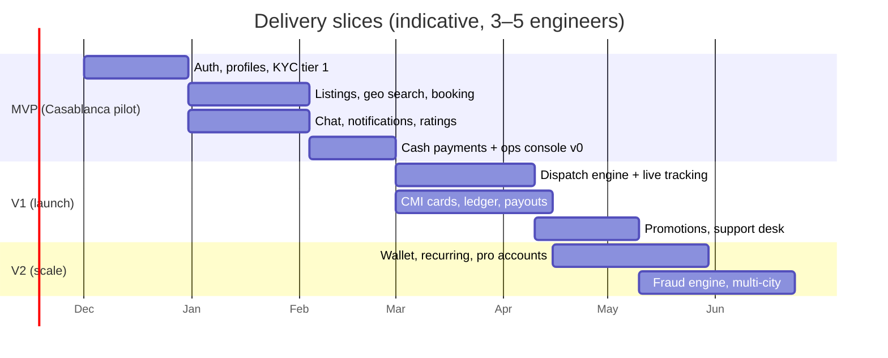

# 01 · Product & scope

## Personas

## Capability map

## Glovo parity matrix

| Glovo capability | Hawma equivalent | Phase |
|---|---|---|
| Browse partners near me | Browse providers/services near me (geo search) | MVP |
| Place order, track live | Book a job, track provider live (en route → arrived → in progress) | MVP (status) / V1 (live map) |
| Courier assignment (auto-dispatch) | **Dispatch engine**: broadcast / nearest-first matching for on-demand jobs | V1 |
| Pay by card / cash / wallet | CMI card, cash, Hawma wallet, mobile money | MVP cash · V1 card · V2 wallet |
| Prime subscription | **Hawma+** (zero service fee, priority support) | V3 |
| Promo codes, vouchers | Promotions engine | V1 |
| Ratings both ways | Two-way ratings, verified by completed job | MVP |
| In-app chat & calls | Chat + masked-number voice (proxy) | MVP chat · V2 calls |
| Support chat, refunds | Support desk with SLA, refunds, dispute workflow | V1 |
| Courier earnings, shifts | Provider earnings, availability windows, payouts | V1 |
| Partner (merchant) portal | Provider business profile (pro accounts, teams) | V2 |
| City ops tooling | Ops console: zones, surge, dispatch board | V1–V2 |
| Fraud & safety | Risk engine, KYC tiers, device fingerprint | V1–V2 |
| Multi-city, multi-currency | Multi-city zones (MAD only) | V2 |

## Scope slicing

## MVP definition (what must be real, not demo)

- Phone-number login with OTP; customer + provider modes in one app.
- Provider onboarding with CIN photo, selfie, manual review in the ops console.
- Geo-searchable listings; booking request → accept → complete → rate.
- Cash payment recorded in the ledger; service fee accounting.
- Push + in-app chat; basic support tickets.
- Ops console v0: KYC queue, bookings list, user lookup, ban/suspend, refunds (manual).
