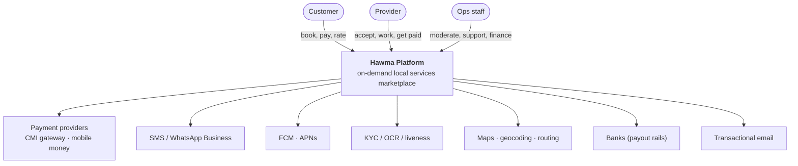
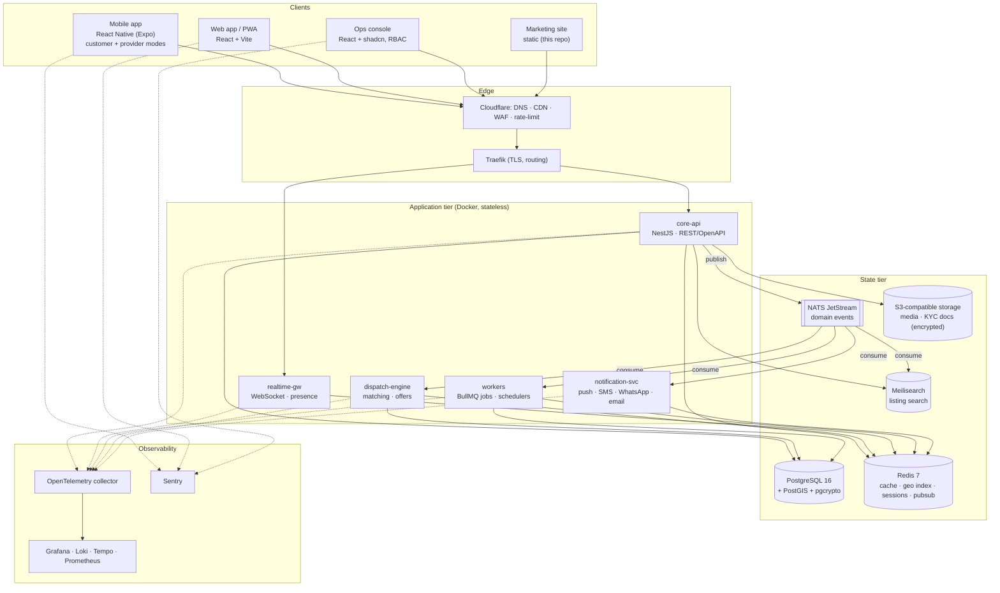
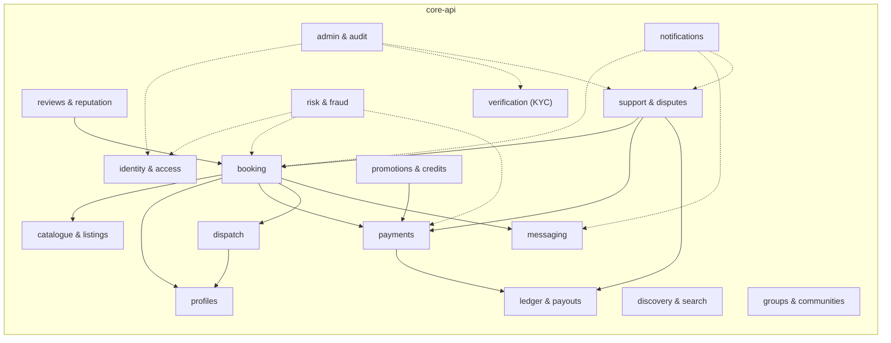
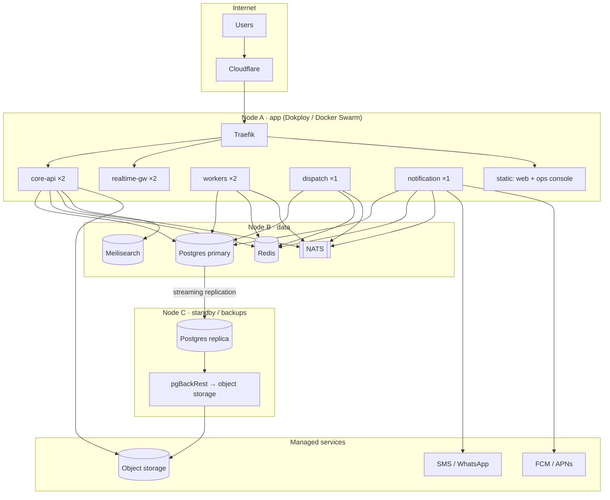
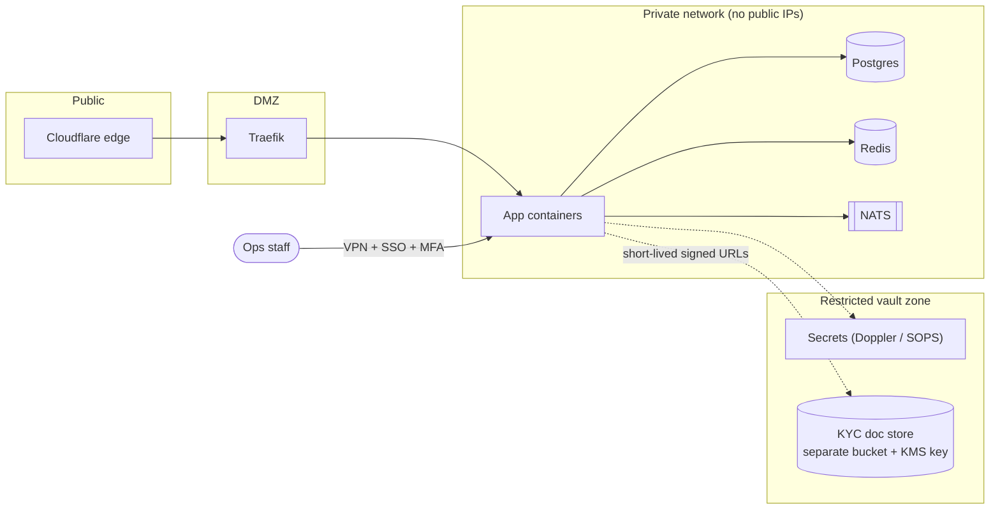

# 02 · System architecture

## 2.1 Context (C4 level 1)

## 2.2 Containers (C4 level 2)

## 2.3 Core API — internal component view

Rule: **modules talk through public service interfaces or domain events, never through each other's tables.** Enforced with an architecture test (`dependency-cruiser`) in CI.

## 2.4 Deployment topology (production, phase 1)

Scale path: split Node A into an app pool behind a load balancer → move Postgres to managed HA → extract `dispatch`, `realtime`, `notification` first (already separate processes) → Kubernetes only when the team and load justify it.

## 2.5 Network & trust zones

## 2.6 Technology choices (summary)

| Concern | Choice | Why |
|---|---|---|
| Language | TypeScript end-to-end | One language for API, web, mobile, shared types and validation |
| Backend | NestJS (Fastify adapter) | Opinionated modules/DI fit a modular monolith; mature ecosystem |
| API | REST + OpenAPI 3.1, generated typed clients | Simple, cacheable, tooling-rich; WebSocket for realtime |
| DB | PostgreSQL 16 + PostGIS | Relational integrity for money/bookings; geo queries built in |
| ORM/migrations | Drizzle ORM + SQL migrations | Typed SQL, no magic, easy review |
| Cache/geo/queues | Redis 7 (BullMQ, GEO, pub/sub) | One tool covers cache, locations, jobs, fan-out |
| Event bus | NATS JetStream | Light, persistent streams, easy ops, scales beyond Redis pub/sub |
| Search | Meilisearch | Typo-tolerant, multilingual (AR/FR), geo filter, trivial ops |
| Mobile | React Native + Expo | Shares TS/types with web; OTA updates; one app, two modes |
| Web/ops | React + Vite + Tailwind + shadcn | Same design system as today |
| Auth | Phone OTP → short JWT + rotating refresh | Phone is the identity in Morocco; passkeys later |
| Files | S3-compatible (Scaleway/R2/MinIO) | Cheap, signed URLs, separate KYC bucket |
| Observability | OpenTelemetry → Grafana stack + Sentry | Vendor-neutral |
| CI/CD | GitHub Actions → Dokploy (blue/green) | Already in place |
