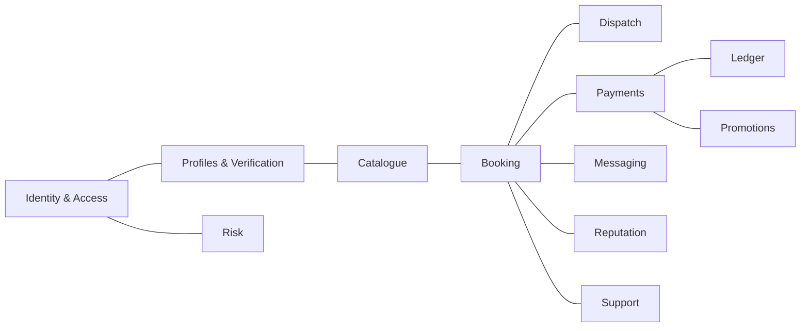
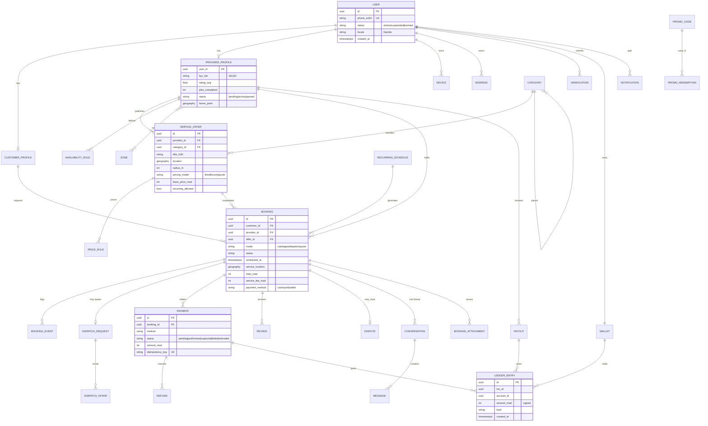
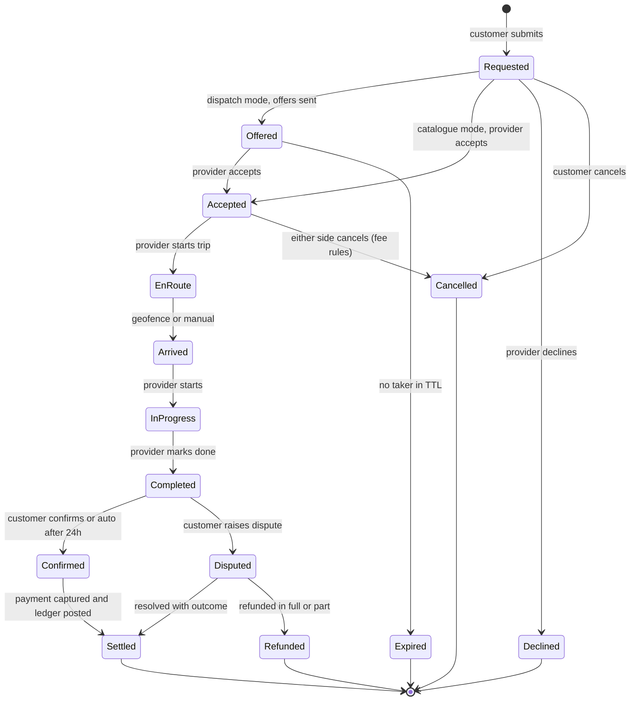
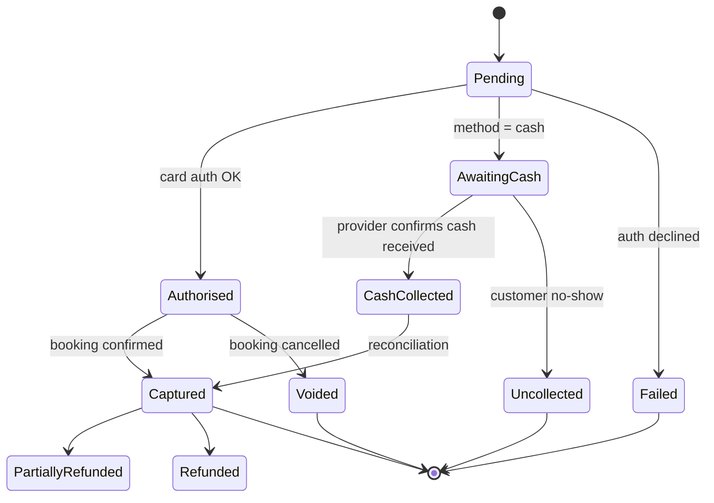
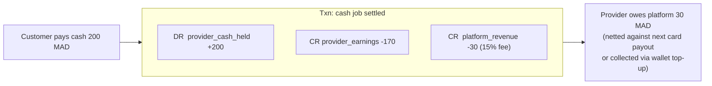
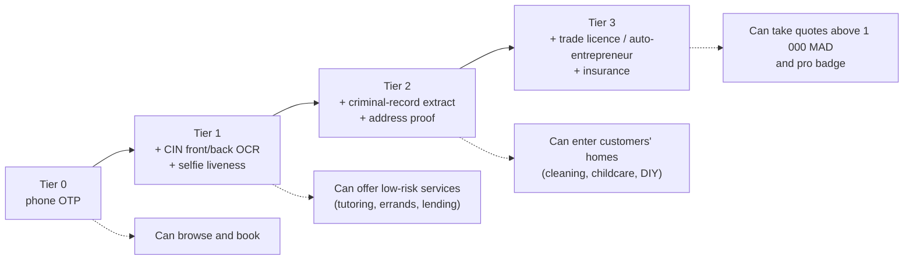

# 03 · Domain model

## 3.1 Bounded contexts

## 3.2 Entity-relationship diagram (core)

## 3.3 Booking state machine

Transitions are **commands** validated by the booking aggregate; every transition appends a `BOOKING_EVENT` and publishes a domain event (`booking.accepted`, `booking.completed`, …).

## 3.4 Payment state machine

## 3.5 Ledger model (double-entry)

Accounts: `customer_wallet`, `provider_earnings`, `provider_cash_held`, `platform_revenue`, `platform_float`, `promo_expense`, `payment_gateway_clearing`, `refund_reserve`. Invariant: sum of every transaction = 0. A nightly job verifies it and reconciles against gateway reports.

## 3.6 Provider verification tiers

