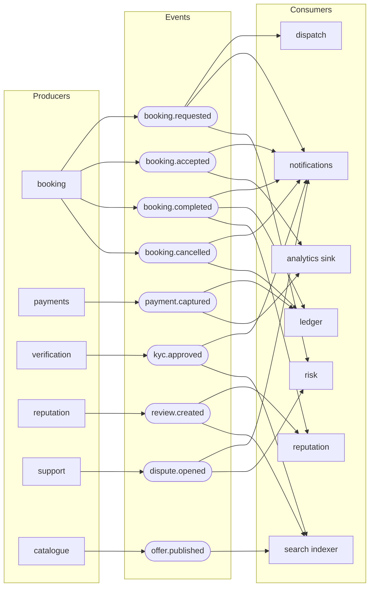
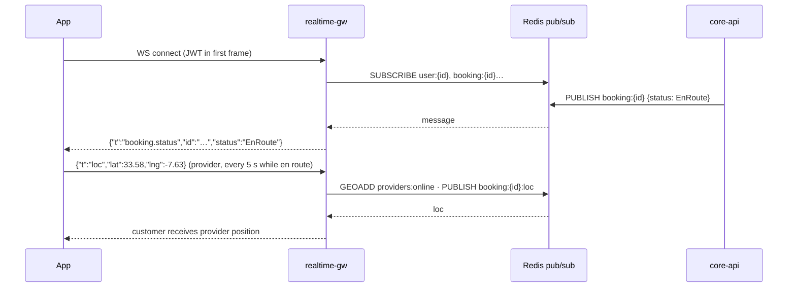

# 04 · Backend modules, events & API

## 4.1 Module responsibilities

| Module | Owns (tables) | Public interface | Emits events |
|---|---|---|---|
| identity | user, device, session, otp_challenge | `register`, `verifyOtp`, `refresh`, `revoke` | `user.registered`, `user.suspended` |
| profiles | customer_profile, provider_profile, address | `getProfile`, `switchMode` | `provider.activated` |
| verification | verification, kyc_document | `submit`, `review`, `tierOf` | `kyc.submitted`, `kyc.approved`, `kyc.rejected` |
| catalogue | category, service_offer, price_rule, availability_rule | `publish`, `quote`, `slotsFor` | `offer.published`, `offer.updated` |
| discovery | (reads search index) | `search`, `nearby`, `suggest` | – |
| booking | booking, booking_event, recurring_schedule, attachment | `request`, `accept`, `start`, `complete`, `cancel` | `booking.*` |
| dispatch | dispatch_request, dispatch_offer | `open`, `offer`, `claim` | `dispatch.offered`, `dispatch.claimed`, `dispatch.expired` |
| payments | payment, refund, gateway_event | `createIntent`, `capture`, `refund` | `payment.*` |
| ledger | wallet, ledger_entry, payout | `post`, `balance`, `schedulePayout` | `ledger.posted`, `payout.paid` |
| messaging | conversation, message | `send`, `history`, `markRead` | `message.sent` |
| reputation | review, provider_score | `rate`, `scoreOf` | `review.created`, `score.changed` |
| promotions | promo_code, redemption, credit | `apply`, `redeem` | `promo.redeemed` |
| support | ticket, dispute, evidence | `open`, `resolve` | `dispute.opened`, `dispute.resolved` |
| notifications | notification, preference, template | `notify` | – |
| risk | risk_signal, rule, block_list | `assess` | `risk.flagged` |
| admin | audit_log, staff_user, role | `can`, `audit` | – |

## 4.2 Event catalogue and consumers



Event envelope (JSON, versioned):

```json
{
  "id": "01JD…ULID",
  "type": "booking.accepted",
  "version": 1,
  "occurredAt": "2026-11-07T17:01:47Z",
  "actor": { "type": "user", "id": "…" },
  "aggregate": { "type": "booking", "id": "…" },
  "data": { "providerId": "…", "scheduledAt": "…" },
  "trace": { "traceId": "…" }
}
```

Reliability: **transactional outbox** (event row written in the same DB transaction, relayed to NATS), consumers are idempotent (dedupe on `event.id`), poison messages go to a dead-letter stream with alerting.

## 4.3 API surface (REST, versioned `/v1`)

| Area | Endpoints (examples) |
|---|---|
| Auth | `POST /auth/otp/request` · `POST /auth/otp/verify` · `POST /auth/refresh` · `DELETE /auth/session` |
| Me | `GET /me` · `PATCH /me` · `POST /me/mode` · `GET/POST /me/addresses` |
| Verification | `POST /verifications` · `POST /verifications/:id/documents` (signed upload) |
| Catalogue | `GET /categories` · `POST /offers` · `PATCH /offers/:id` · `GET /offers/:id/slots` |
| Discovery | `GET /search?q=&cat=&lat=&lng=&radius=&sort=` · `GET /offers/nearby` |
| Booking | `POST /bookings` · `POST /bookings/:id/{accept,decline,start,arrive,complete,confirm,cancel}` · `GET /bookings?role=` |
| Dispatch | `POST /dispatch-requests` · `POST /dispatch-offers/:id/{accept,reject}` |
| Payments | `POST /bookings/:id/payment-intent` · `POST /payments/webhooks/:gateway` |
| Wallet | `GET /wallet` · `POST /wallet/topups` · `GET /payouts` |
| Chat | `GET /conversations` · `GET /conversations/:id/messages` · WS `message.send` |
| Reviews | `POST /bookings/:id/reviews` · `GET /providers/:id/reviews` |
| Support | `POST /tickets` · `POST /bookings/:id/disputes` |
| Promos | `POST /promos/validate` |
| Ops | `/ops/*` (separate audience, RBAC, audit-logged) |

Conventions: cursor pagination, `Idempotency-Key` header on every money/booking write, RFC 7807 problem+json errors, `Accept-Language` drives i18n of messages, ETag on read-heavy catalogue endpoints.

## 4.4 Realtime protocol



Channels: `user:{id}` (notifications, status), `booking:{id}` (status, ETA, location), `conversation:{id}` (chat, typing, read receipts). Missed events are recovered with `GET /sync?since=cursor` after reconnect.
