# 05 · Key flows (sequence diagrams)

## F1 · Sign-up / login with phone OTP

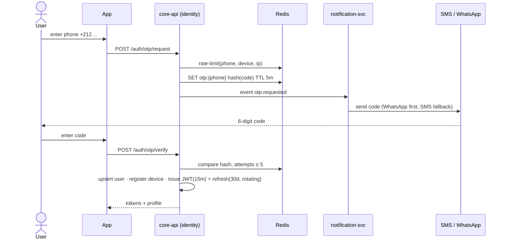

## F2 · Provider onboarding & KYC

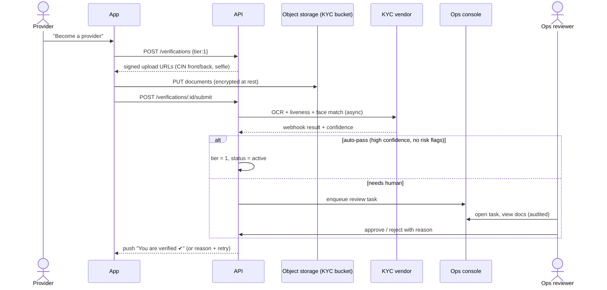

## F3 · Discover and book from the catalogue

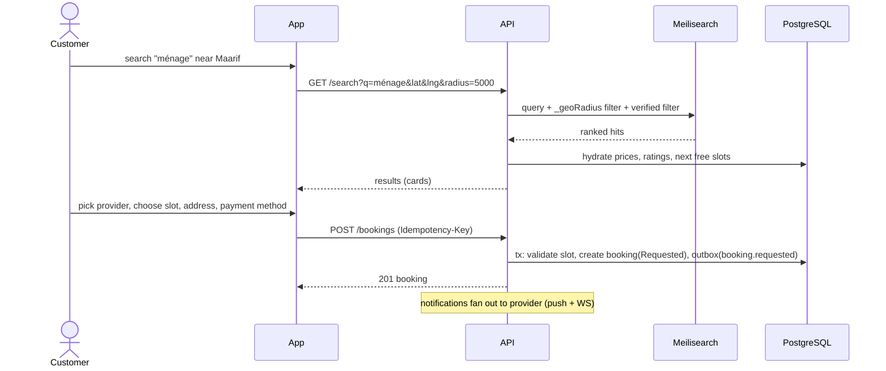

## F4 · Provider accepts and fulfils

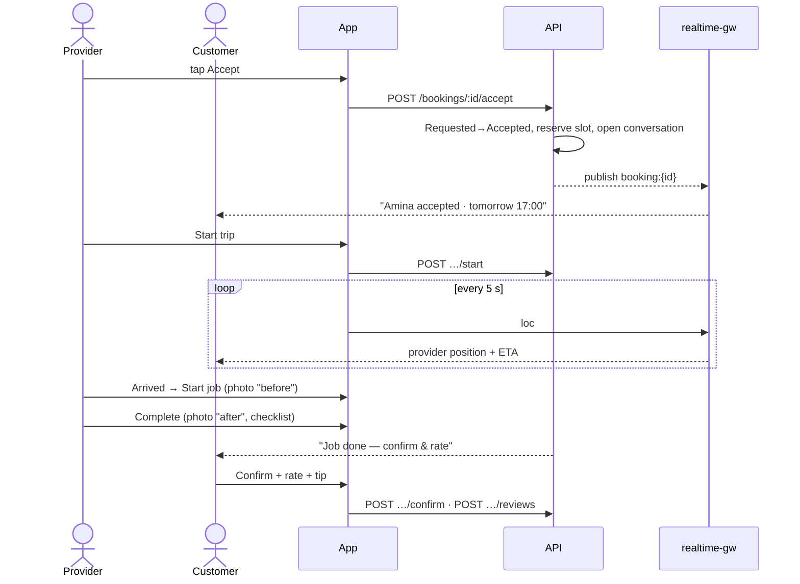

## F5 · On-demand dispatch (errands, urgent plumbing, rides)

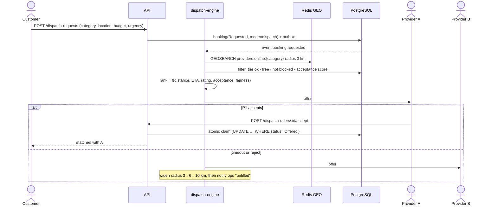

## F6 · Card payment (CMI) with authorisation then capture

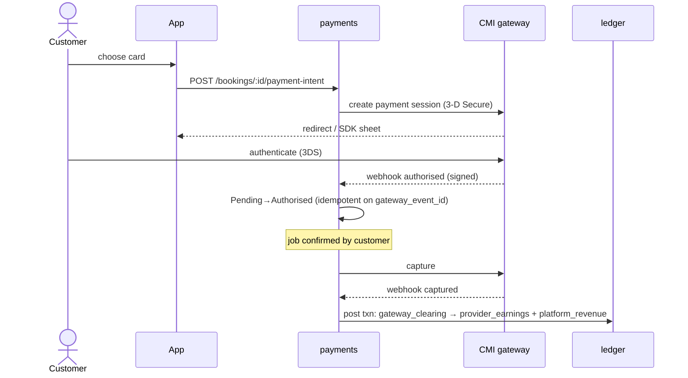

## F7 · Cash payment and settlement

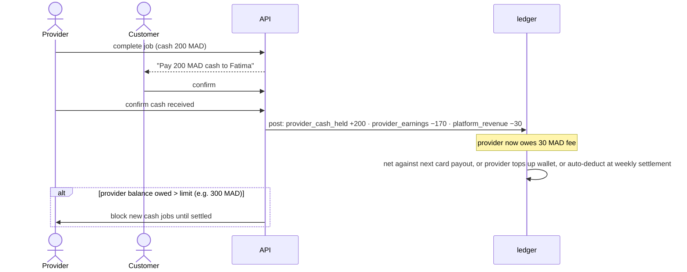

## F8 · Cancellation with fee rules

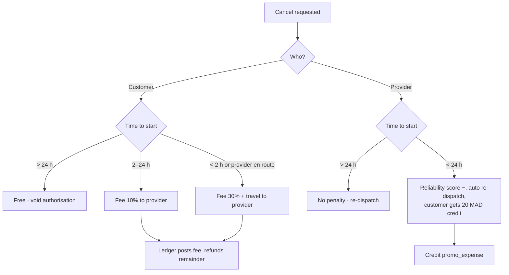

## F9 · Dispute and refund

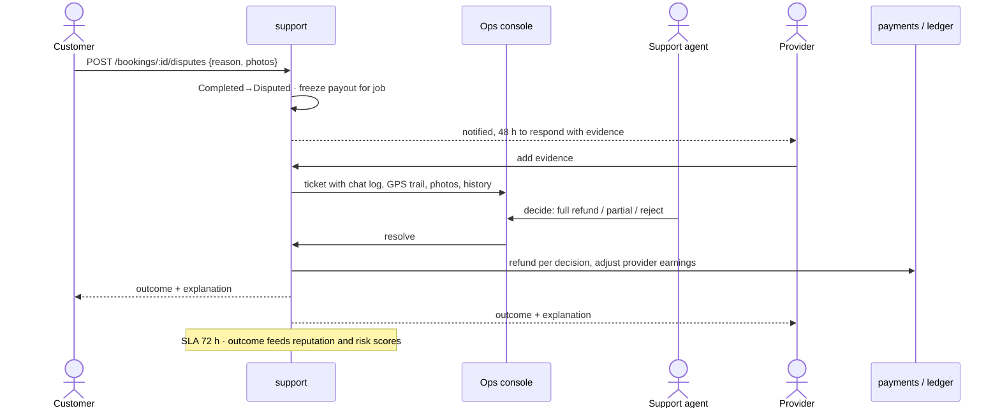

## F10 · Provider payout

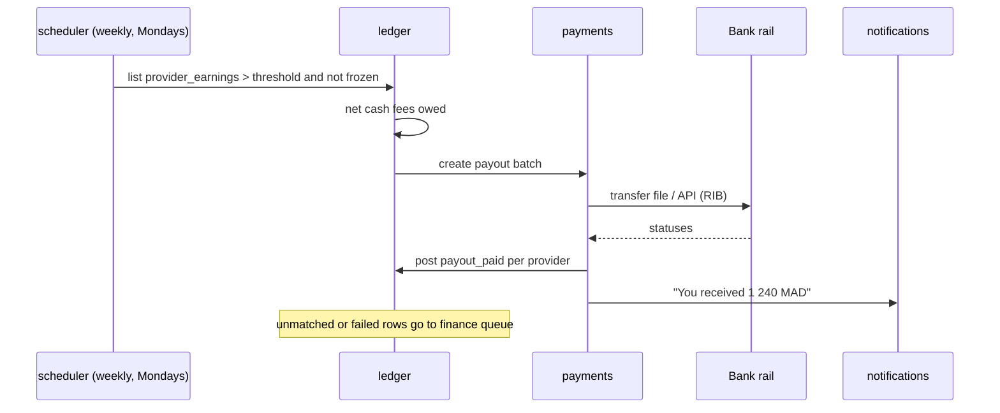

## F11 · Chat with moderation

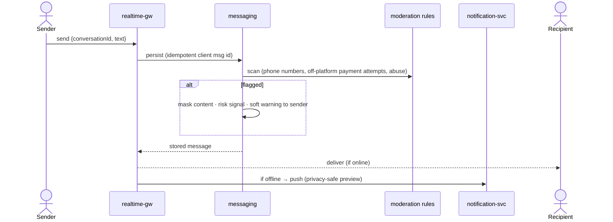

## F12 · Recurring booking

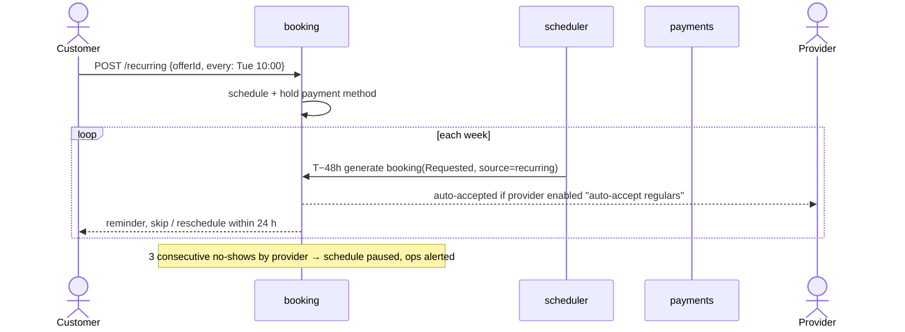
