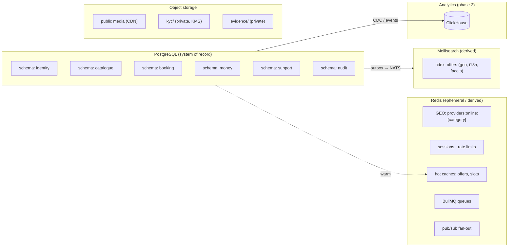
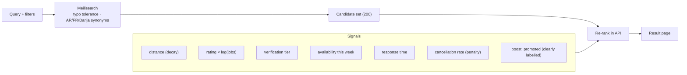
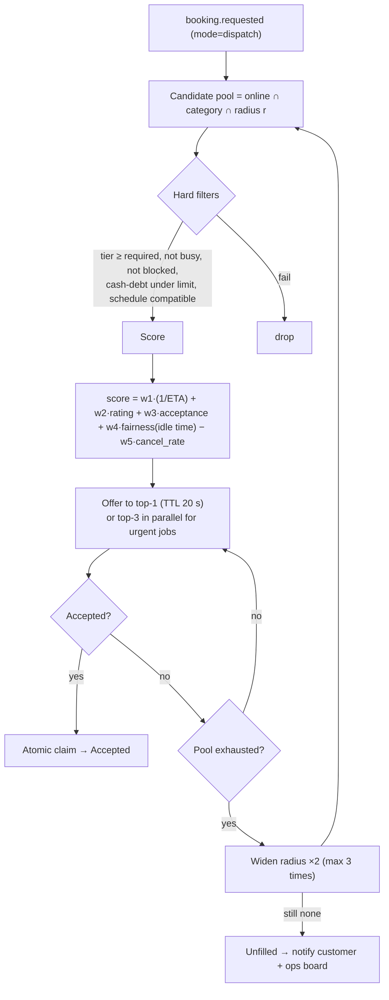
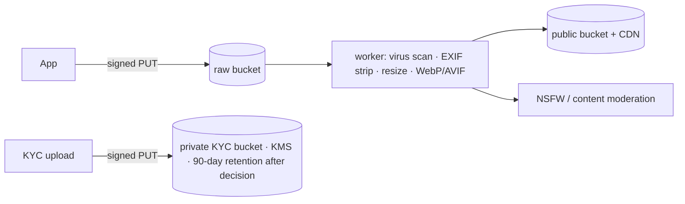

# 06 · Data, geo, search & realtime

## 6.1 Data ownership map

Each module owns a **Postgres schema**; cross-schema foreign keys are forbidden except to `identity.user(id)`. Reads across modules go through interfaces. This is what makes later extraction possible.

## 6.2 Geo strategy

| Need | Mechanism |
|---|---|
| "Providers within R km of me" (catalogue) | Meilisearch `_geoRadius` + `_geoPoint` sort, on `location` of the offer |
| "Who is online and free right now" (dispatch) | Redis `GEOADD providers:online:{cat}` updated by the provider's heartbeat; TTL 30 s sliding presence key |
| Authoritative zone checks (serves this area?) | PostGIS `ST_DWithin` on `geography` + `zone` polygons |
| Privacy | Customers only see a **~300 m rounded** provider home point; precise address shared only after booking acceptance |
| Routing / ETA | Maps provider (OSRM self-hosted or Mapbox) with 60 s cache by cell pair; haversine fallback |

## 6.3 Search relevance

Synonym dictionary includes Darija transliterations (`nqa`, `plombier`, `sebbak`, `tkhdim`…) maintained by ops; query language auto-detected (Arabic script vs Latin).

## 6.4 Dispatch matching algorithm

Weights are config in the DB, tunable per city and A/B-testable. All offers/outcomes are logged for learning-to-rank later.

## 6.5 Caching & consistency

| Data | Cache | Invalidation |
|---|---|---|
| Categories, i18n strings | CDN + app memory | version key |
| Offer detail | Redis 60 s | `offer.updated` event |
| Provider slots | computed, Redis 15 s | `booking.*` events |
| Search | none (Meili is the cache) | reindex on events |
| Session | Redis | TTL / revoke |

Booking, payments and ledger are **never served from cache**; they read from the Postgres primary inside transactions with `SERIAL`/row locks on contested rows (slot reservation, dispatch claim).

## 6.6 Media pipeline

## 6.7 Backup & retention

| Data | RPO | RTO | Retention |
|---|---|---|---|
| PostgreSQL | ≤ 5 min (WAL archiving) | ≤ 1 h | PITR 14 days, monthly snapshots 12 months |
| Object storage | versioned | – | media: life of account; KYC: 90 days after decision unless legally required |
| Redis | none (rebuildable) | minutes | – |
| Audit & ledger | immutable, replicated | – | 10 years (accounting law) |
