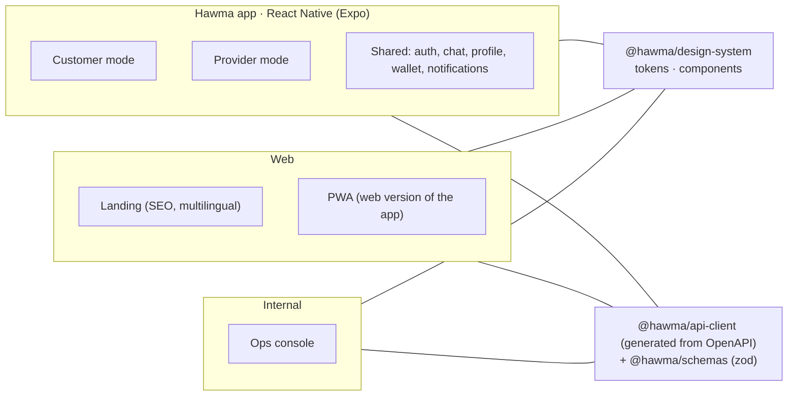
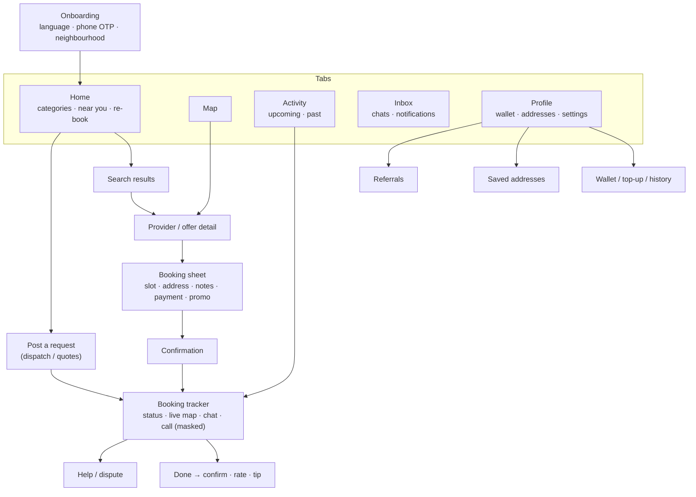
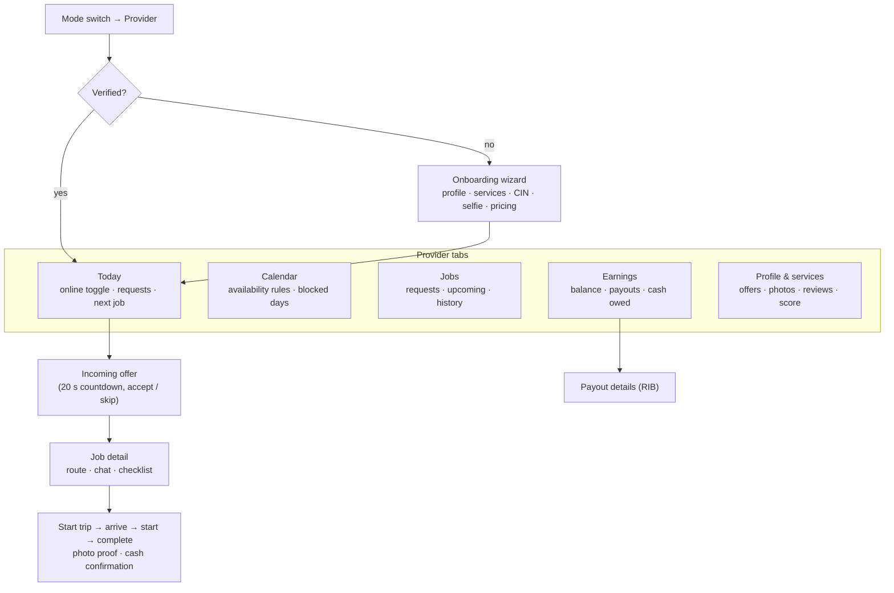
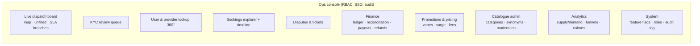

# 07 · Clients

## 7.1 Client portfolio

One app, two modes (like Uber's rider/driver in separate apps vs Airbnb's host/guest in one): neighbours are often *both* customer and provider, so a mode switch beats two installs. A dedicated provider app can be split off later if the experience diverges.

## 7.2 Customer navigation map

## 7.3 Provider navigation map

## 7.4 Ops console modules

Roles: `support`, `trust_safety`, `city_ops`, `finance`, `catalogue`, `admin`, `read_only`. Every sensitive action requires a reason and is written to the immutable audit log; refunds and payouts above thresholds need four-eyes approval.

## 7.5 Design system

- Tokens: emerald `#0b3d33`, saffron `#f2b84b`, terracotta `#d9552b`, sand `#f7f2e9`; Fraunces display + Inter / IBM Plex Sans Arabic.
- Components (shadcn-based, shared web/mobile where possible): Button, Input, Sheet, Tabs, Badge, Avatar, Rating, ListingCard, StatusTimeline, MapPin, PriceTag, EmptyState, Toast.
- RTL-first: logical properties only (`ms-`, `ps-`, `start`/`end`), mirrored icons, locale-aware numerals (Latin digits default, Arabic-Indic optional).
- Accessibility: WCAG 2.2 AA, 48 px touch targets, dynamic type, reduced motion.
- Performance budgets: first meaningful paint < 2 s on 3G for web; app cold start < 2.5 s on a mid-range Android; list scroll 60 fps.

## 7.6 Offline & low-bandwidth

- Read-through cache for categories, recent searches, upcoming bookings; booking creation queued with idempotency key when offline.
- Image CDN with width-based variants and AVIF/WebP; blur-hash placeholders.
- Compressed JSON, pagination ≤ 20 items, delta sync for chat.
