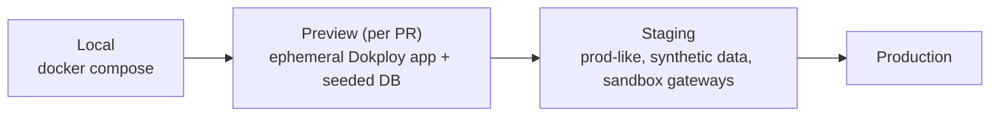
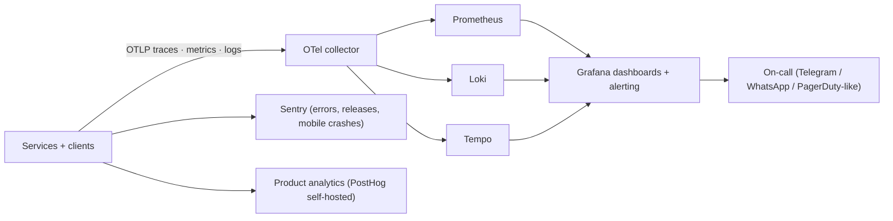
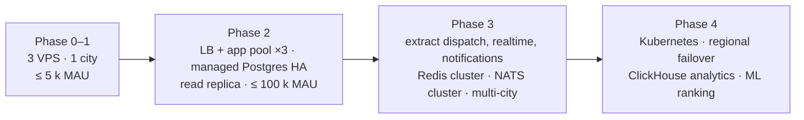

# 08 · Infrastructure & DevOps

## 8.1 Environments



## 8.2 CI/CD pipeline

```mermaid
flowchart LR
  C["git push / PR"] --> L["lint · typecheck · arch-test"]
  L --> U["unit + integration tests<br/>(Postgres, Redis, NATS service containers)"]
  U --> CT["contract tests<br/>OpenAPI diff · pact"]
  CT --> B["build images (cache) · SBOM · vulnerability scan"]
  B --> E2E["Playwright e2e + axe + screenshots"]
  E2E --> M{"merge to main"}
  M --> STG["deploy staging (auto)"]
  STG --> SMK["smoke + migration dry-run"]
  SMK --> APPR{"manual approval"}
  APPR --> BG["blue/green deploy prod<br/>health gate · auto-rollback"]
  BG --> MIG["DB migrations: expand → deploy → contract"]
```



Migrations follow **expand / contract** so every deploy is backward compatible with the previous version; destructive changes ship one release later.

## 8.3 Observability



**SLOs** (initial):

| Journey | SLI | SLO |
|---|---|---|
| API availability | non-5xx / total | 99.9 % monthly |
| Booking creation | p95 latency | < 400 ms |
| Search | p95 latency | < 300 ms |
| Realtime delivery | event → client p95 | < 1.5 s |
| Dispatch | request → first offer | < 5 s |
| Notifications | booking event → push p95 | < 10 s |
| Payment webhooks | processed within | 30 s |

**Key business dashboards:** requests, fill rate, time-to-match, cancel rate, GMV, take rate, provider utilisation, NPS, dispute rate, cash-owed exposure.

## 8.4 Scaling path



Capacity sanity check (phase 2): 100 k MAU ≈ 8 k DAU; peak ≈ 150 booking writes/min, 2 k search/min, 3 k concurrent WebSockets, 600 location pings/s from online providers — comfortably within a 4-vCPU API pool plus one Postgres primary.

## 8.5 Cost envelope (rough, to validate with vendor quotes)

| Item | Phase 1 / month |
|---|---|
| 3 VPS (4 vCPU / 8 GB each) | ~ 60–90 € |
| Object storage + CDN | ~ 10–20 € |
| SMS/WhatsApp OTP (≈ 0.02–0.05 €/msg) | volume-dependent |
| Maps / geocoding | free tier → usage |
| Sentry / Grafana Cloud (or self-hosted) | 0–30 € |

## 8.6 Runbooks (to write before launch)

Payment gateway outage · SMS provider outage (fail over to WhatsApp) · Redis loss (rebuild geo index) · Postgres failover · mass-cancellation incident · data-subject request · leaked credential rotation · app-store rejection.

## 8.7 Repository layout (target monorepo)

```
hawma/
├─ apps/
│  ├─ api/            # NestJS modular monolith (core-api, workers, dispatch entrypoints)
│  ├─ realtime/       # WebSocket gateway
│  ├─ mobile/         # Expo app (customer + provider modes)
│  ├─ web/            # landing + PWA
│  └─ ops/            # ops console
├─ packages/
│  ├─ schemas/        # zod schemas, shared types, event contracts
│  ├─ api-client/     # generated OpenAPI client
│  ├─ design-system/  # tokens + components
│  └─ config/         # eslint, tsconfig, tailwind presets
├─ infra/             # docker compose, Dokploy templates, Terraform later
├─ docs/architecture/ # this pack
└─ .github/workflows/
```
