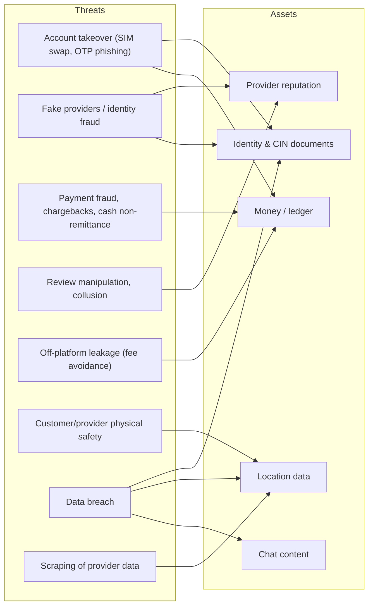
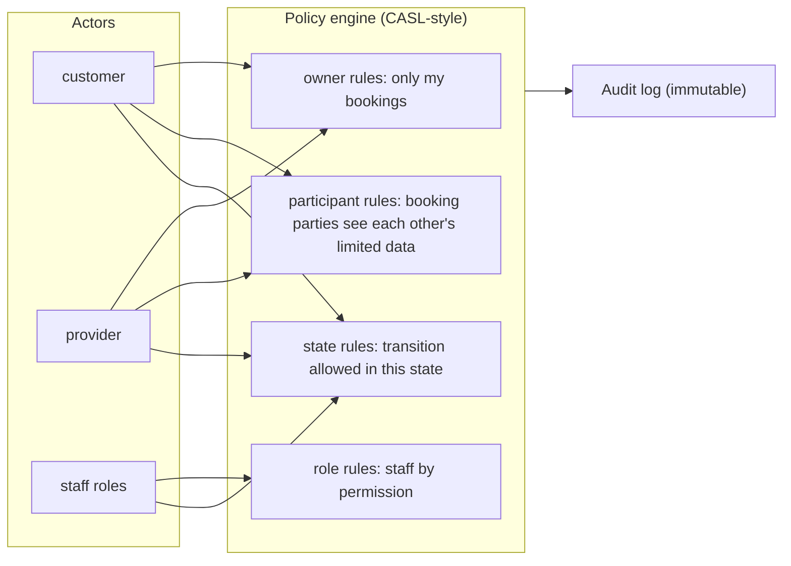
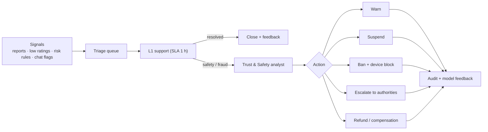

# 09 · Security, trust & compliance

## 9.1 Threat model (STRIDE summary)

## 9.2 Controls

| Threat | Controls |
|---|---|
| Account takeover | OTP rate-limits per phone/device/IP, device binding, step-up for payout changes, session list + remote revoke, optional passkey/PIN |
| Fake providers | KYC tiers, liveness + face-match, CIN OCR cross-check, duplicate-document detection, manual review for high-risk categories |
| Payment fraud | 3-D Secure, velocity rules, device fingerprint, new-account limits, cash-debt caps, delayed payouts for new providers |
| Review manipulation | Only completed bookings can review, graph analysis for collusion rings, text moderation, review response window |
| Off-platform leakage | Chat masking of phone numbers/IBAN, in-app calling proxies, perks for staying on-platform (insurance, dispute protection, loyalty) |
| Physical safety | Share-my-job link, SOS button with ops escalation, tiered KYC for home entry, rate limits for first jobs, two-way ratings with safety flags |
| Data breach | Encryption in transit (TLS 1.3) and at rest, field-level encryption for CIN numbers, KMS-held keys, least-privilege IAM, secrets vault, break-glass access with audit |
| Scraping | Auth-gated detail endpoints, rate limiting, location fuzzing, bot detection at the edge |
| App security | OWASP MASVS L1, certificate pinning (optional), jailbreak/root signals, secure storage for tokens |
| Supply chain | Dependabot/Renovate, lockfiles, SBOM, signed images, CI secret scanning |

## 9.3 Access control model

## 9.4 Privacy & compliance (Morocco)

- **Law 09-08** on personal data protection and the **CNDP**: declare/obtain authorisation for processing, explicit consent, purpose limitation, data-subject rights (access, rectification, deletion), restrictions on transfers abroad. *Needs legal review before launch; this pack is not legal advice.*
- **Data residency:** prefer hosting in the EU or Morocco with documented safeguards; keep KYC documents in a dedicated store with short retention.
- **Payments:** card data never touches Hawma servers (hosted payment page/SDK) → PCI SAQ-A scope. Provider payouts and wallet balances may fall under Bank Al-Maghrib rules on payment services — **verify licensing needs (e.g., partner with a licensed payment institution)** before holding customer funds.
- **Provider status:** clarify auto-entrepreneur / tax rules, receipts (invoices for fees), VAT on platform fees.
- **Consumer protection:** clear pricing, cancellation terms, dispute process, T&Cs in Arabic and French.
- **Minors & sensitive categories:** childcare and elder-care require Tier 2+ and stricter review.

## 9.5 Trust & safety operations

