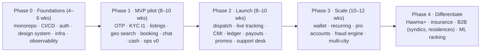

# 10 · Roadmap, ADRs & open questions

## 10.1 Phased roadmap

## 10.2 Architecture decision records

| # | Decision | Alternatives considered | Rationale | Revisit when |
|---|---|---|---|---|
| ADR-1 | Modular monolith with outbox + NATS | Microservices from day 1; plain monolith without events | Operability for a small team; clean extraction path | > 15 engineers or a module needs independent scaling |
| ADR-2 | TypeScript everywhere (NestJS, RN, React) | Go/Kotlin backend; Flutter | Shared schemas/types, hiring pool, speed | CPU-bound hotspots (dispatch) → Go/Rust worker |
| ADR-3 | PostgreSQL + PostGIS as system of record | MongoDB; DynamoDB | Transactions for money/bookings, geo, mature ops | > 5 TB or hot partitions |
| ADR-4 | Redis GEO for live provider positions | PostGIS only; dedicated geo service | Sub-ms radius queries, TTL presence | > 200 k concurrent online providers |
| ADR-5 | Meilisearch for discovery | Elasticsearch/OpenSearch; Postgres FTS | Great typo tolerance, simple ops, geo built-in | complex aggregations, > 5 M offers |
| ADR-6 | Double-entry ledger in Postgres | Balance columns; third-party ledger | Auditability, reconciliation, refunds | Regulatory / volume demands (e.g., Formance/Modern Treasury) |
| ADR-7 | Cash-first with provider debt caps | Card-only | Market reality in Morocco; adoption | Card share > 60 % |
| ADR-8 | One mobile app with two modes | Separate provider app | Neighbours are both sides; one install | UX divergence or store policy |
| ADR-9 | REST + OpenAPI + WS | GraphQL | Simpler caching, generated clients, less ops | Many bespoke client query shapes |
| ADR-10 | Phone OTP via WhatsApp-first | SMS only | Cheaper/deliverable in MA, higher conversion | Provider cost/ban risk changes |

## 10.3 Risk register

| Risk | Impact | Likelihood | Mitigation |
|---|---|---|---|
| Cold start (supply/demand imbalance per area) | High | High | Launch hyper-local, seed providers, ops-assisted matching, group/building onboarding |
| Cash non-remittance by providers | Med | High | Debt caps, netting against payouts, deposit for new providers |
| Disintermediation (taking jobs off-app) | High | Med | Chat masking, insurance/dispute protection, repeat-booking perks |
| Regulatory (payments, data) | High | Med | Legal review, licensed PSP partner, CNDP filing |
| Safety incident | Very high | Low | KYC tiers, SOS, ops response, insurance |
| Single-VPS failure early on | Med | Med | Replica + backups + tested restore |
| OTP cost / deliverability | Med | Med | WhatsApp-first, fallback, rate limits, passkeys later |

## 10.4 Open questions — what I need from you

I proceed on the assumptions in 00-README; these answers will change specifics (not the overall shape):

1. **Scope of "like Glovo":** neighbourhood services only, or also **delivery** (restaurants, groceries)? The architecture supports an errands vertical today; restaurant/merchant catalogues would add a *merchant* side (menu, inventory, order prep) — a larger module set.
2. **Launch city & first 3 categories?** (suggest Casablanca: cleaning, tutoring, handyman)
3. **Payments:** which PSP/bank relationship exists or is preferred (CMI, Payzone, M2T, Orange Money…)? Do you hold, or plan to hold, an entity that can legally hold customer funds?
4. **Business model:** commission % (assumed 15 %), subscription (Hawma+), provider fees, ads?
5. **Team & timeline:** how many engineers, target pilot date?
6. **Brand/legal entity:** company name, domain, app-store accounts.
7. **Do you want a native mobile app first (App Store / Play) or PWA first?** (I recommend Expo native app + PWA.)
