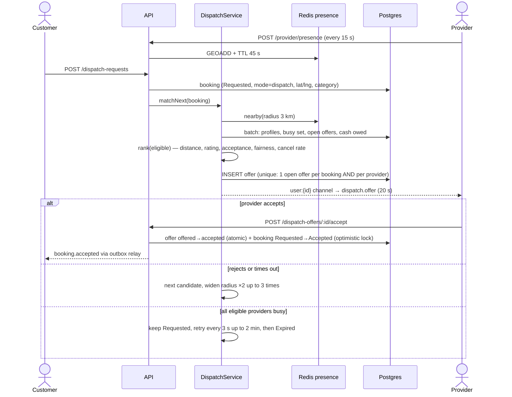
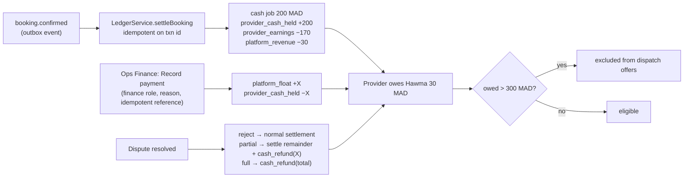
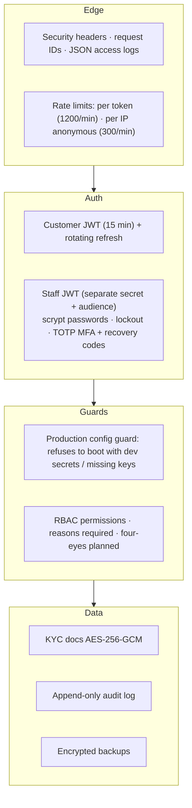

# 11 · Implementation status (what is actually built and running)

*Last updated 2026-11-11. This page describes the **running system**; documents 01–10 describe the target design.*

## 11.1 What runs in production today

```mermaid
flowchart TB
  subgraph Clients
    APK["Android app (Expo)<br/>customer + provider modes"]
    WEB["Web app /app (React PWA)"]
    OPS["Ops console /ops"]
    LAND["Landing /"]
  end
  subgraph Dokploy["Dokploy host (single VPS)"]
    TR["Traefik<br/>/ → web · /api → api (path stripped)"]
    WEBC["hawma (nginx static)"]
    API["hawma-api (NestJS/Fastify)<br/>REST + WebSocket /ws<br/>outbox relay · dispatch ticker"]
    PG[("hawma-db<br/>PostgreSQL 16")]
    RD[("hawma-redis<br/>OTP limits · presence GEO · pub/sub")]
    BK["hawma-backup<br/>pg_dump every 6 h → encrypted volume"]
  end
  APK & WEB & OPS & LAND --> TR
  TR --> WEBC & API
  API --> PG & RD
  BK --> PG
  BK -. logs result .-> PG
```

| Concern | Status | Notes |
|---|---|---|
| Phone OTP login, rotating refresh tokens | ✅ | Pilot mode returns the code in the response; WhatsApp Cloud + SMS senders implemented, **need credentials** |
| Catalogue, geo search, ranking, privacy-fuzzed locations | ✅ | Postgres + haversine/bbox; Meilisearch not needed at pilot scale |
| Scheduled bookings with slot picker | ✅ | DB exclusion constraint prevents overlaps; Morocco time rules explicit (ADR-11) |
| Rescheduling | ✅ | Customer only, before the job starts |
| On-demand dispatch (Glovo-style) | ✅ | Presence, ranked sequential offers, 20 s TTL, radius widening, queueing |
| Live tracking + status push | ✅ | WebSocket gateway; outbox relay delivers booking events |
| Ratings & reviews | ✅ | Derived provider stats |
| Double-entry ledger, cash fees, debt cap | ✅ | Idempotent postings, DB-enforced balance, append-only |
| Disputes & refunds | ✅ | Reject / full / partial; ledger effects |
| KYC documents | ✅ | AES-256-GCM at rest, magic-byte checks, audited views |
| Ops console (RBAC, MFA, audit, finance, disputes, KYC) | ✅ | TOTP MFA available; enforcement flag `OPS_REQUIRE_MFA` |
| Backups + restore drill | ✅ | Same-host volume; **off-site copy needs S3 credentials** |
| Card payments, payouts, wallet top-ups | ⏳ | Needs a payment provider / licensed partner |
| Push notifications | ⏳ | Needs Firebase credentials |
| HTTPS / real domain | ⏳ | Needs a domain |
| Promotions, referrals, recurring bookings | ⏳ | Not started |

## 11.2 On-demand dispatch as implemented

## 11.3 Money flow as implemented

Invariants enforced **in the database**: every ledger transaction sums to zero (deferred constraint trigger), ledger and audit log are append-only, one open dispatch offer per booking and per provider, no overlapping active slot bookings per provider.

## 11.4 Security controls in place

## 11.5 Verification in CI

| Workflow | What it proves |
|---|---|
| `CI` | typecheck, migrations on real Postgres, 139 tests (unit, HTTP e2e, real-Postgres concurrency), production-mode smoke, Docker build |
| `Dispatch load test` | 150 concurrent requests / 40 providers: no double offers, no double jobs, p95 latency |
| `Backup and restore drill` | encrypted backup restores into a fresh DB with identical data and intact invariants |
| `Accessibility` | axe WCAG 2.2 AA on landing, web app, ops console |
| `Architecture check` | every diagram renders; ops/web flows in a real browser against mocked APIs |
| `Android APK` | builds a release APK and publishes it as a GitHub release |
